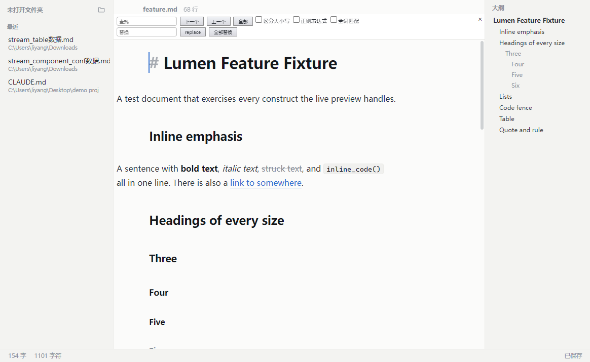
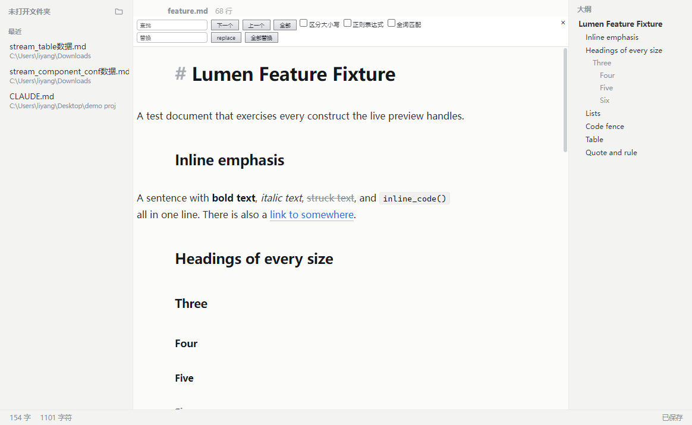
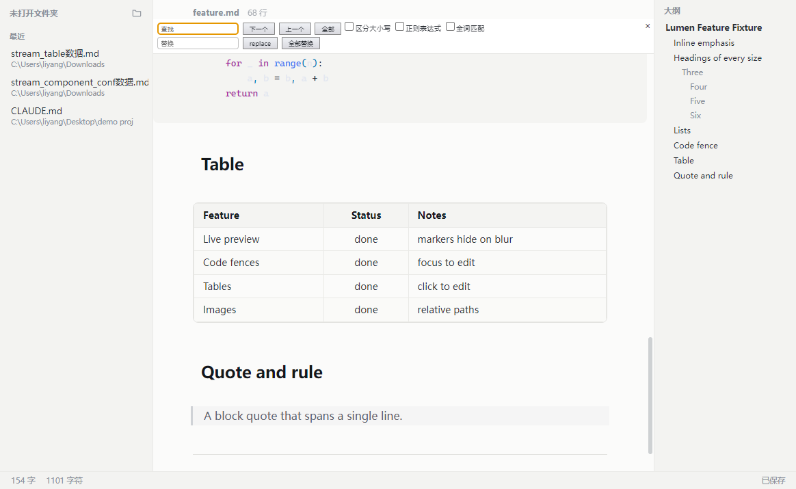

# Lumen

一个本地优先的 Markdown 编辑器，主打 **Typora 式实时预览**。

磁盘上的文件始终是原始的 Markdown 源码 —— 你看到的是它的渲染结果，
不是另一份文档模型。没有往返转换，没有格式丢失。

[](LICENSE)
[](https://github.com/zzulee/lumen/releases)
[](https://www.electronjs.org/)
[](https://codemirror.net/)

---

## 界面预览

| 深色主题 | 浅色主题 |
|---|---|
|  |  |



---

## 下载安装

前往 [Releases](https://github.com/zzulee/lumen/releases) 页面下载最新版本：

| 文件 | 说明 | 大小 |
|---|---|---|
| `Lumen-Setup-<版本>.msi` | Windows 安装包（MSI），可从零安装 | ~90 MB |
| `Lumen-Setup-<版本>.exe` | Windows 安装包（NSIS），支持选择安装路径 | ~85 MB |
| `Lumen-Portable-<版本>.exe` | 免安装绿色版，双击即用 | ~78 MB |

> **注意**：发布包**未做代码签名**，Windows SmartScreen 可能提示"未知发布者"。
> 这是开源免费软件的常态，选择"更多信息 → 仍要运行"即可。

**系统要求**：Windows 10 / 11（x64）。

---

## 核心特性

### 实时预览

光标停在构造内部时，Markdown 标记（`**`、`` ` ``、`#`、围栏）**显示**出来方便编辑；
光标移开，标记**自动隐藏**，文字立即呈现最终样式。

| 支持 | 行为 |
|---|---|
| 标题 | `#` ~ `######`，含 Setext 形式 |
| 强调 | `**粗体**`、`*斜体*`、`~~删除线~~` |
| 行内代码 | `` `code` `` 带背景与等宽字体 |
| 链接 | `[文字](url)`，失焦后只留文字 |
| 图片 | `` 渲染为内嵌图片，支持相对路径 |
| 围栏代码块 | 失焦后隐藏围栏行，按语言高亮 |
| 表格 | 失焦后渲染成真正的网格，点击即可回到源码编辑 |
| 列表 | 项目符号替换为 `•`，任务列表渲染为复选框 |
| 引用 | 左侧竖线 + 淡色文字 |
| 分隔线 | `---` 渲染为水平线 |

### Markdown 源码即唯一真相

编辑器内部就是 CodeMirror 6 实例，内容永远是原文。
这意味：

- 用任何其他编辑器打开，格式完全一致
- Git diff 干净可读
- 不会出现只存不回的隐藏格式

### 其他

- **文件夹浏览**：打开整个笔记目录，侧栏树形展示，自动过滤非 Markdown 文件
- **最近文件**：记录最近 12 个文件，可单独移除
- **大纲面板**：按标题层级生成可点击大纲，当前章节高亮跟随光标
- **导出**：HTML（自包含单文件）与 PDF（A4 排版，隐藏界面元素）
- **明暗主题**：深色 / 浅色，记忆上次选择
- **中英双语**：默认中文，可在「视图 → 语言」切换
- **字数统计**：实时显示字数 / 字符数 / 行数
- **未保存保护**：关窗、打开新文件、新建文件前都会提示保存

---

## 快捷键

| 操作 | Windows / Linux |
|---|---|
| 新建文件 | `Ctrl+N` |
| 打开文件 | `Ctrl+O` |
| 打开文件夹 | `Ctrl+Shift+O` |
| 保存 | `Ctrl+S` |
| 另存为 | `Ctrl+Shift+S` |
| 在文档中查找 | `Ctrl+F` |
| 切换大纲面板 | `Ctrl+Shift+B` |
| 切换侧栏 | `Ctrl+Shift+E` |
| 浅色主题 | `Ctrl+Shift+L` |
| 撤销 / 重做 | `Ctrl+Z` / `Ctrl+Y` |
| 放大 / 缩小 / 实际大小 | 视图菜单（Electron 默认加速键） |

macOS 下 `Ctrl` 对应 `Command`。

---

## 开发

### 环境要求

- Node.js 18+
- npm 8+

### 起步

```bash
git clone https://github.com/zzulee/lumen.git
cd lumen
npm install
npm run start      # 构建渲染层并启动 Electron
```

### 常用命令

```bash
npm run build          # 只构建渲染层到 src/renderer/bundle.js
npm run build:watch    # 监听模式，改动自动重建
npm run start          # 构建 + 启动应用
npm run dist           # 构建 Windows 安装包到 release/
npm run release        # 同上，但显式不发布到 GitHub
```

> `npm run build` 在 Windows 上若 Electron 仍开着，会因文件锁失败；
> `build.js` 内置了 6 次重试与退避，仍失败就先关掉应用。

### 截图验收

内置了一个开发用的截图档架，会逐区域截图并输出装饰统计，然后自动退出：

```bash
# 开发模式
npx electron . --capture ./shots fixtures/feature.md

# 打包后的应用同样支持
./release/win-unpacked/Lumen.exe --capture ./shots fixtures/feature.md
```

它会把以下内容写到标准输出，便于回归比对：

- `console errors`：渲染层未捕获的错误
- `marker test`：光标移入/移出时标记数量的变化
- `perRegion`：每个区域（代码 / 表格 / 引用 / 列表）的装饰计数
- `decoErrors`：装饰构建异常

另有未保存保护的专项检查：

```bash
npx electron . --close-check
```

---

## 项目结构

```
lumen/
├── src/
│   ├── main/                    Electron 主进程
│   │   ├── main.js              窗口、菜单、IPC、关闭守卫、截图档架
│   │   └── preload.js           contextBridge 暴露的安全 API
│   ├── shared/
│   │   └── i18n.js              中英文词表（主进程与渲染层共用）
│   └── renderer/                渲染层
│       ├── app.js               应用装配：文件、侧栏、大纲、导出、语言
│       ├── index.html           页面骨架
│       ├── styles.css           主题令牌 + 界面 + 文档排版
│       └── editor/
│           ├── document.js      CodeMirror 实例、主题、导出 HTML
│           ├── live-preview.js  实时预览装饰引擎
│           ├── outline.js       大纲提取
│           └── print.js         导出/打印用样式表
├── build/                       打包资源（应用图标）
├── fixtures/                    示例与验收用 Markdown
├── build.js                     esbuild 构建脚本
└── package.json                 依赖与 electron-builder 配置
```

### 实时预览是怎么工作的

`live-preview.js` 是核心，思路是**只加装饰，绝不改文档**：

1. 用 Lezer 的 Markdown 语法树遍历构造
2. 对每个构造，判断光标是否落在其范围内（`revealed`）
3. 在范围内 → 用 `Decoration.mark` 把标记染成提示色
4. 不在范围内 → 用 `Decoration.replace` 把标记直接隐藏，或替换成 widget（项目符号、复选框、表格、水平线）

因为「哪些标记可见」取决于选区，而 view plugin 不会因选区变化重跑，
这里用的是 `StateField`，每次事务都会重算。

**性能**：编辑时只重建光标附近 ±2000 字符的窗口，窗口外靠 `StateField.map` 带过来。
若出现装饰重叠（大跳转、粘贴），自动回退到全量重建，绝不丢装饰。

### 安全模型

- `contextIsolation: true`、`nodeIntegration: false`
- 渲染层只能通过 preload 暴露的白名单 API 访问文件系统
- 页面设置了 CSP：脚本只允许本地文件，禁止内联脚本与远程脚本；样式只允许本地与内联样式，图片允许 `data:` / `file:` / `https:`
- 外部链接交给系统浏览器打开，不在应用内导航

---

## 打包与签名

`npm run dist` 使用 electron-builder 产出三种 Windows 目标：NSIS 安装包、MSI 安装包、便携版。

**代码签名**：项目未配置证书，构建时会跳过签名。
如有证书，设置环境变量即可：

```bash
CSC_LINK=/path/to/cert.pfx
CSC_KEY_PASSWORD=yourpassword
npm run dist
```

---

## 参与贡献

欢迎提 Issue 与 PR。

提交前建议先跑一遍：

```bash
npm run build
npx electron . --capture ./shots fixtures/feature.md
npx electron . --close-check
```

确认 `console errors` 为空、`markersInside` 大于 0、`decoErrors` 为空。

---

## License

[MIT](LICENSE)
